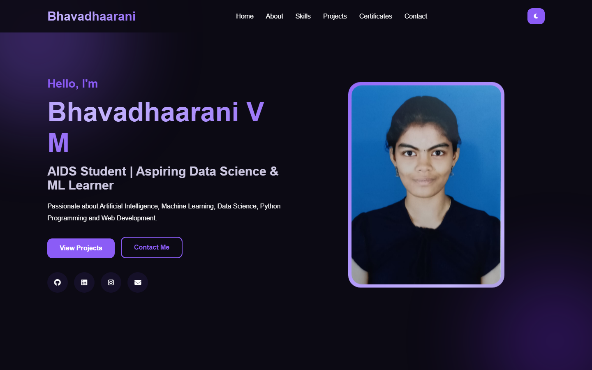
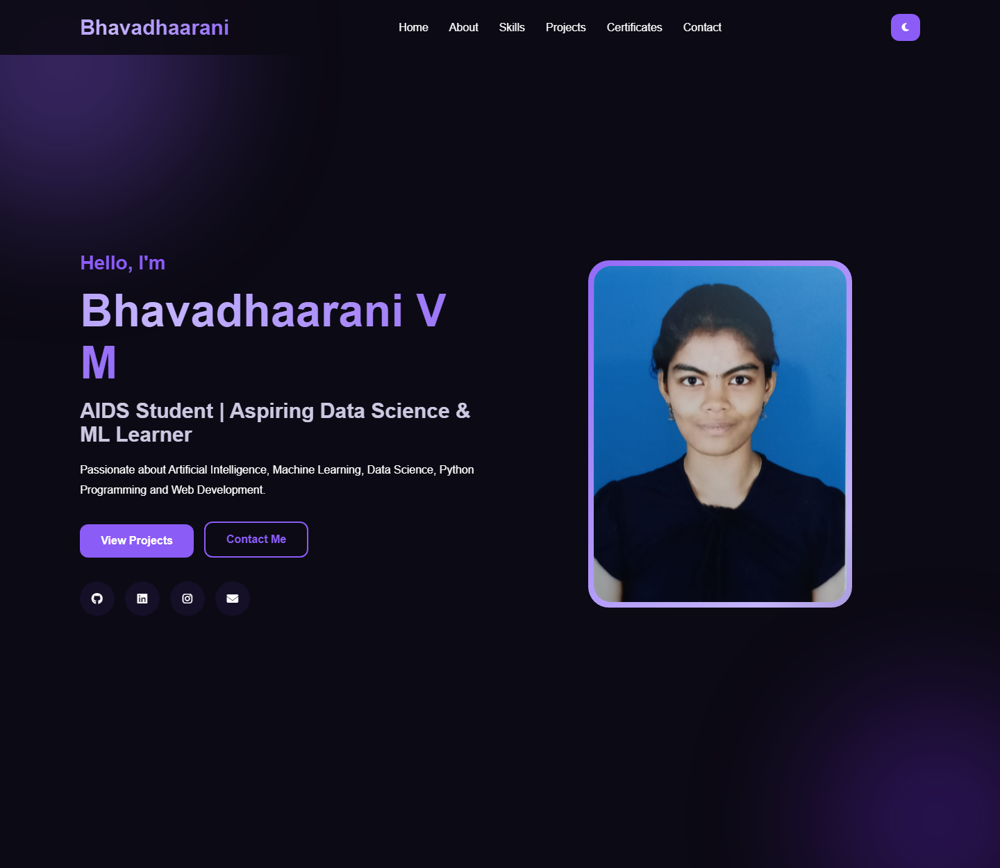
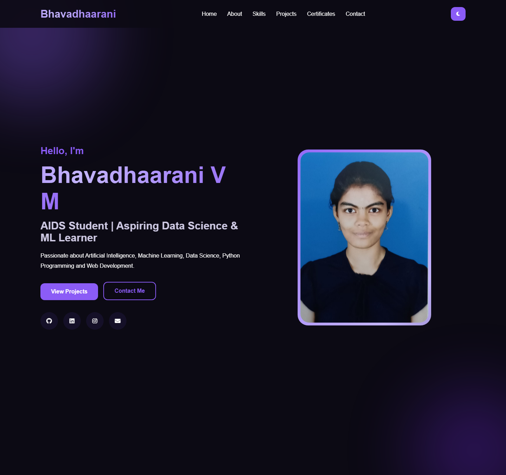
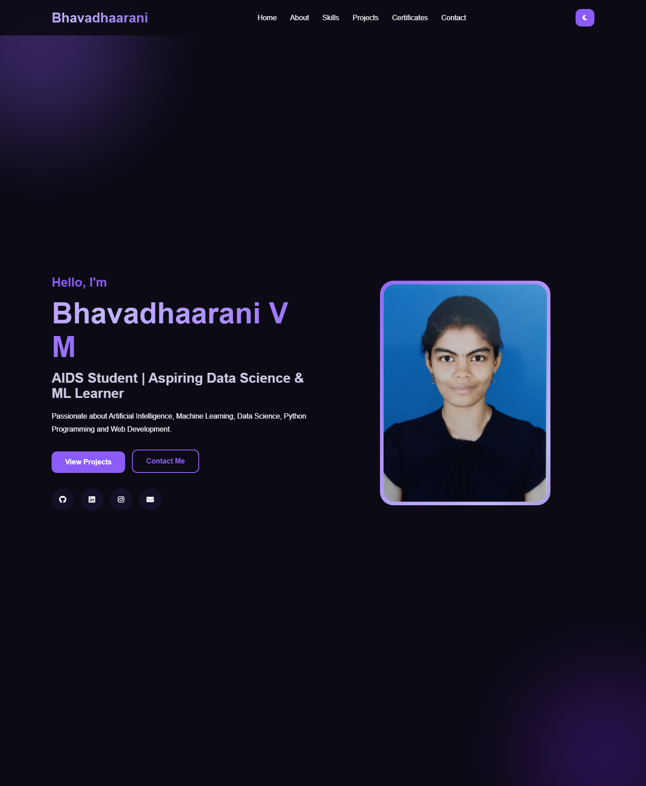
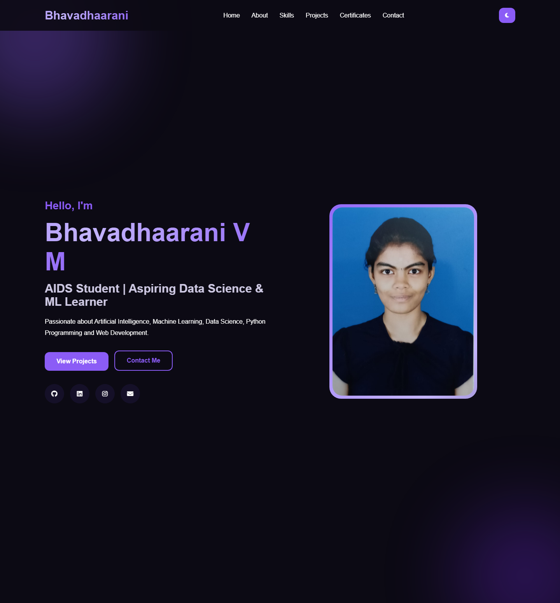
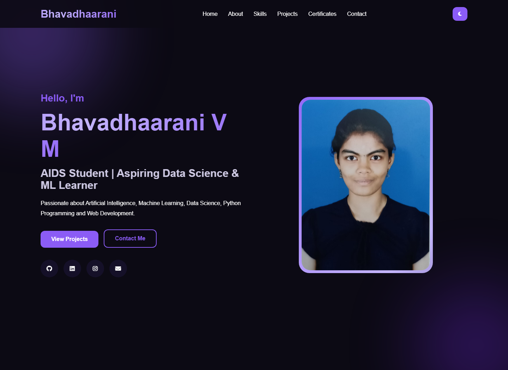

# Bhavadhaarani V M — Personal Portfolio Website

A modern, fully responsive personal portfolio website built with **React 19 + Vite**, featuring a
professional **violet theme**, rich scroll-reveal animations, hover micro-interactions, a dark/light
mode toggle and six complete sections — Hero, About, Skills, Projects, Certificates and Contact.


---

## 🎬 Demo Video

**Watch the full walkthrough of the portfolio — Hero, About, Skills, Projects, Certificates and
Contact sections (recorded from the live site):**

<video src="demo-video/portfolio-demo.mp4" controls muted width="100%"></video>

> If the player does not load above, [download / view the demo video here](demo-video/portfolio-demo.mp4).

---

## 📸 Screenshots

### Home / Hero
Floating profile photo with an animated shifting gradient frame, drifting ambient violet glow
orbs, staggered fade-in text and a shimmering gradient name.

<p align="center"></p>

### About
Personal journey card and quick stats (certificates, GitHub projects, technical skills) with hover
lift and glow effects.

<p align="center"></p>

### Skills
Seven technical skill cards — Java, OOPs, Python, Web Interface, DBMS, Data Science and Data
Structure — each with a description line, revealing on scroll with staggered animation.

<p align="center"></p>

### Projects
All projects with descriptions, technology tags and live links — each card lifts and glows on
hover with an animated project icon.

<p align="center"></p>

### Certificates
Eleven achievement cards (Claude AI, Infosys Python & Java, Java, JavaScript, Digital Skills,
Microsoft AWS Canva, Communication Skills) viewable in full size.

<p align="center"></p>

### Contact
Direct contact details plus a working message form with glowing focus states and slide-in
contact boxes on hover.

<p align="center"></p>

---

## ✨ Work Summary — What Was Built

| Work | Details |
| --- | --- |
| **Theme & Design** | Professional violet palette (`#8b5cf6` accent) with deep violet-black backgrounds in dark mode and soft lavender tints in light mode, applied consistently across every section, gradient, border, tag and footer |
| **Dark / Light Mode** | One-tap toggle in the header that smoothly transitions the entire site |
| **Scroll-Reveal Animations** | Every section title, card and panel fades up when scrolled into view using an IntersectionObserver, with staggered delays so cards appear in a wave |
| **Hero Animations** | Staggered entrance for heading/text, floating profile photo, animated shifting gradient frame and two drifting blurred violet glow orbs in the background |
| **Gradient Animated Text** | Logo, name and section title highlights shimmer continuously through a violet gradient |
| **Button Effects** | Primary button has a shine sweep + lift on hover; secondary button fills with violet from the bottom |
| **Card Micro-Interactions** | Skill/project/certificate/stat cards lift with glowing borders on hover; icons scale up and glow |
| **Navigation** | Animated underline on link hover; the fixed header shrinks and gains a shadow when scrolling |
| **Responsive Layout** | Fully responsive from desktop to mobile — grids collapse, hero reorders, social icons center |
| **Accessibility** | `prefers-reduced-motion` support disables all animations for users who need it |

---

## 🛠️ Tech Stack

| Layer | Technology |
| --- | --- |
| UI | React 19, JSX |
| Build Tool | Vite 8 |
| Icons | Font Awesome 6.5 |
| Styling | Pure CSS (custom properties, keyframes, grid, flexbox) |
| Linting | oxlint |

---

## 📂 Project Structure

```
portfoliobhava-react/
├── screenshots/               # Section screenshots used in this README
├── demo-video/                # Demo video walkthrough of the site
├── public/                    # Static assets (profile photo, certificate images)
├── src/
│   ├── components/
│   │   ├── Header.jsx         # Fixed nav + dark/light toggle + scroll shrink
│   │   ├── Hero.jsx           # Intro, buttons, social icons, profile photo
│   │   ├── About.jsx          # Journey + quick stats
│   │   ├── Skills.jsx         # 7 skill cards with descriptions
│   │   ├── Projects.jsx        # 5 project cards with live links
│   │   ├── Certificates.jsx    # 11 certificate cards
│   │   ├── Contact.jsx         # Contact info + message form
│   │   └── Footer.jsx          # Footer with social icons
│   ├── App.jsx                # Layout + scroll-reveal observer
│   ├── index.css              # Violet theme, animations, responsive rules
│   └── main.jsx               # React entry point
├── index.html
├── package.json
└── vite.config.js
```

---

## 🚀 Running Locally

```bash
# 1. Install dependencies
npm install

# 2. Start the dev server
npm run dev        # → http://localhost:5173

# 3. Production build
npm run build      # → ./dist

# 4. Lint
npm run lint
```

Requirements: Node.js 18+, any modern browser.

---

## 👩‍💻 About Me

**Bhavadhaarani V M** — B.Tech Artificial Intelligence and Data Science (AIDS) student,
passionate about Data Science, Machine Learning, Python Programming and Web Development.

- **GitHub:** [bhavadhaaranivmaids29-prog](https://github.com/bhavadhaaranivmaids29-prog)
- **LinkedIn:** [Bhava Dhaarani V M](https://www.linkedin.com/in/bhava-dhaarani-v-m-74519b387/)
- **Email:** bhavadhaarani.vm.aids29@princedrkvasudevan.com

---

Made with 💜 and React.
